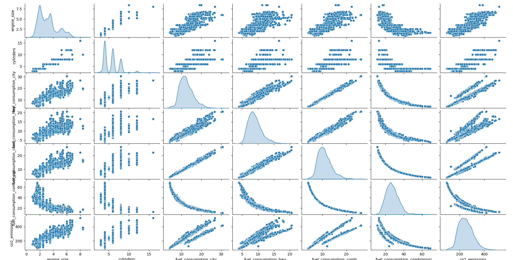
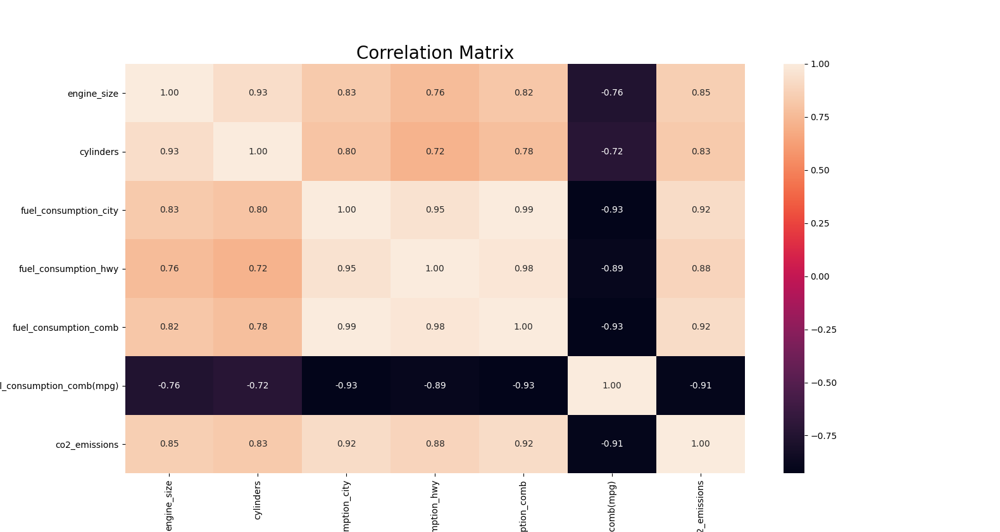
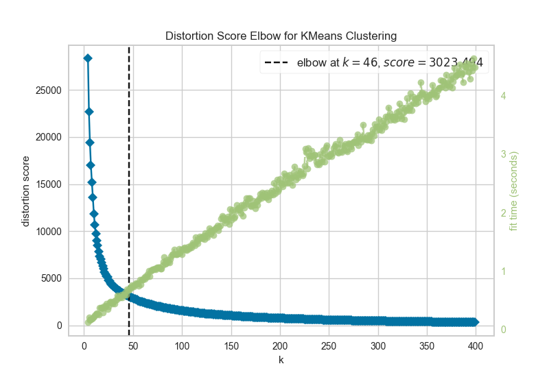

# CO₂ Emissions Predictor

A desktop machine-learning app that **estimates a car's CO₂ emissions (g/km)** from a few technical specs and **suggests similar cars** from a real dataset of vehicles sold in Canada.



## Problem

Emission figures are not always at hand when comparing cars. Given engine size, number of cylinders and fuel consumption (city / highway / combined), can we predict CO₂ emissions and show comparable models? The project combines **supervised regression** (prediction) and **unsupervised clustering** (similar-car recommendation) behind a simple Tkinter GUI.

## Approach

- **Data**: Government of Canada *Fuel consumption ratings* open data (make, model, vehicle class, engine size, cylinders, transmission, fuel type, fuel consumption, CO₂ emissions). See [Dataset](#dataset).
- **Exploratory analysis**: correlation matrix, distributions, outlier inspection (`experiments/`).
- **Regression**: Linear SVR, Decision Tree and Random Forest regressors were compared (`src/models.py`, `experiments/tuning_experiments.py` with `GridSearchCV` + 10-fold cross-validation). The app uses a **Random Forest regressor** (`max_depth=7`, `n_estimators=100`).
- **Clustering**: **K-Means** with the number of clusters chosen via the elbow method (`k = 46`, see `docs/elbow_kmeans.png`). The user's car is added to the dataset, clustered, and the cars in the same cluster are returned as "similar cars".
- **GUI**: Tkinter form with input validation (plausible ranges for engine size, cylinders and consumption).

| Correlation matrix | Elbow method for K-Means |
|---|---|
|  |  |

## Tech stack

Python · pandas · NumPy · scikit-learn (RandomForestRegressor, LinearSVR, DecisionTreeRegressor, KMeans, GridSearchCV) · seaborn / matplotlib · Yellowbrick · Tkinter

## Getting started

```bash
git clone https://github.com/raimondoDiSangro/co2-emissions-predictor.git
cd co2-emissions-predictor
python -m venv .venv && source .venv/bin/activate   # Windows: .venv\Scripts\activate
pip install -r requirements.txt

# launch the GUI (run from the repository root)
python -m src.main
```

Tkinter ships with most Python installers; on Debian/Ubuntu install it with `sudo apt install python3-tk`.

Exploratory / tuning scripts (also run from the repository root):

```bash
python experiments/eda_and_model_selection.py
python experiments/tuning_experiments.py
```

## Project structure

```
co2-emissions-predictor/
├── src/
│   ├── main.py          # Tkinter GUI, input validation, orchestration
│   ├── models.py        # regression models (Random Forest used by the app; SVR / Decision Tree for comparison)
│   └── clustering.py    # K-Means "similar cars" search
├── experiments/         # EDA, clustering and hyper-parameter tuning scripts
├── data/co2_emissions.csv
├── docs/                # plots and the original project report (Italian, PDF)
├── requirements.txt
└── LICENSE
```

## Dataset

Fuel consumption ratings, Government of Canada Open Data:
https://open.canada.ca/data/en/dataset/98f1a129-f628-4ce4-b24d-6f16bf24dd64 (Open Government Licence – Canada).

## Background

Built as the final project for the *Knowledge Engineering* (ICon) course at the University of Bari. A detailed report (in Italian) is in [`docs/project_report_it.pdf`](docs/project_report_it.pdf). This repository is a cleaned-up copy of that course project, republished in 2026.

## License

Code: [MIT](LICENSE). Dataset: Open Government Licence – Canada.
